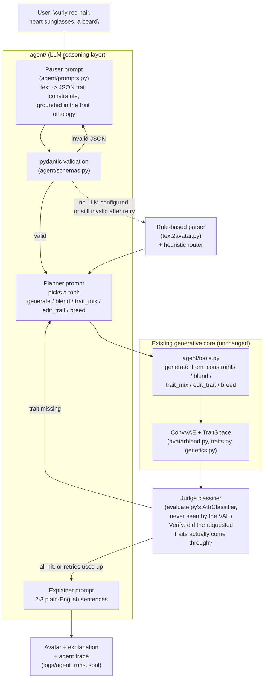

# AvatarBlend Studio

Convolutional VAE (PyTorch) trained on Google Cartoon Set, extended from plain latent blending
(`x* = Decoder(a·z_A + (1-a)·z_B)`) into a small generative "studio", with an LLM agent layered on
top as the reasoning/planning/verification front-end (see [Agent architecture](#agent-architecture)):

| Tab | What it does | How |
|---|---|---|
| **Describe it** | chat: describe an avatar in words (English or Tanglish/Manglish) *or* upload a photo, pick a candidate, keep editing it by chatting | LLM agent: parse text (or guess traits from a photo via the judge classifier) -> plan+act (VAE tool calls) -> verify (judge classifier) -> self-correct -> explain; falls back to a rule-based parser + heuristic router with no API key |
| **Blend** | whole-avatar mixes at 75/50/25% + custom ratio, vs naive pixel blend | linear latent interpolation |
| **Trait Mixer** | hair from A, face shape from B, glasses from A, ... | per-trait latent subspaces (LDA on encoder means, orthogonalised) |
| **Avatar Editor** | change one trait of any avatar (e.g. hair colour -> variant 3) | latent arithmetic toward the target variant's mean |
| **Genetics Lab** | breed litters, pick favourites, evolve generations, family tree | trait-genes inherited from one parent (or blended) + Gaussian mutation |

Any avatar from Describe it can be sent to any other tab as Parent A/B (or opened directly in the
Avatar Editor) with one click, so the chat interface and the four original hands-on tabs are one
shared session, not two separate apps.

## Agent architecture



The VAE stays the only thing that generates pixels - the agent only decides *what* to ask it for, and
checks the result with a classifier the VAE never saw during training. Every arrow into "Rule-based
parser" or the heuristic router is a real fallback path, not aspirational: `agent/llm.py`'s client
reports `.available = False` with no API key, and `agent/agent.py` takes that branch for parsing,
planning, and explaining - see `evaluate_agent.py`'s results below, produced by exactly this fallback
path (no LLM configured in this evaluation run).

## Results (held-out test avatars, `results/metrics_{64,128}.json`)
Judged by an independent attribute classifier trained on real avatars (99-100% accurate on real images,
86% on eye colour). Figures in `results/` are from the 128px model.

| | 64px baseline (CPU, 40 ep) | 128px + perceptual (GPU, 50 ep) |
|---|---|---|
| Reconstruction PSNR | 26.9 dB | 28.4 dB |
| Reconstruction keeps trait (hairstyle / glasses / facial hair) | 64% / 60% / 19% | **98% / 90% / 91%** |
| Trait Mixer: trait taken from A (hairstyle / face shape / glasses) | 59% / 39% / 37% | **98% / 89% / 77%** |
| Trait Mixer: other traits stay B's | 49-62% | **79-89%** |
| Editor: hits requested variant (hairstyle, 1 of 111 / hair colour) | 53% / 84% | **96% / 89%** |

Whole-avatar blending behaves as the proposal predicts: at a=0.75 the result has A's hairstyle 91% of the time
(B's 0%), at a=0.25 B's 93% (A's 0%). Weak spots: 50/50 blends of very different hairstyles are messy
(use the Trait Mixer instead), and skin tone (11 close shades) is only kept ~60-70% of the time.

Design note: an orthogonal-subspace (LDA projection) trait model was tried first and failed
(hairstyle swap 1%); the additive label-offset model in `traits.py` replaced it.

## Agent results (`results/metrics_agent.json`, from `evaluate_agent.py`)

Run on this machine (Apple Silicon MPS, `vae128.pt`) with **no LLM backend configured** - every number
below is the rule-based parser / heuristic planner, run through the exact same pipeline the LLM path
uses. Re-run with `ANTHROPIC_API_KEY` set to add the LLM-vs-rule columns; the script does this
automatically and the README will only ever report numbers it actually printed.

**Parser accuracy** on the 30-prompt held-out test split (`knowledge/prompt_testset.jsonl`):

| category | trait precision/recall | exact-match (right variant ids, not just right trait) |
|---|---|---|
| easy | 100% / 100% | 100% |
| compositional | 100% / 100% | 100% |
| negation | 100% / 100% | 100% |
| code_mixed | 100% / 100% | 87.5% |
| blend_edit | 75% / 75% | 75% |
| **vague** (persona descriptions, e.g. "a friendly librarian") | **0% / 0%** | **0%** |
| **overall** | **93.3% / 93.3%** | **91.7%** |

The `blend_edit` dip (from 100%, and overall from 96.7% / 95%) is one held-out prompt, "make the hair
shorter": the parser now maps "shorter" to short hairstyles (a fix - it used to ignore it and the chat
replaced the avatar), but that item's hand-written gold marks the hair variant as unspecified, so the
scorer counts the extra trait as a false positive. The gold label was deliberately not edited to match
the parser's new output.

`easy`/`compositional`/`negation` gold labels were generated by running `text2avatar.parse()` itself
(see `DATASET.md`), so the rule parser scoring ~100% there is by construction, not a finding.
`code_mixed` prompts here mix English trait nouns with Tamil/Malayalam function words (e.g. "romba
curly hair venum"), so the rule parser still catches the English content word - a harder code-mixed
test (non-English trait nouns) would separate it from an LLM parser further. **`vague` is the real
gap**: a keyword parser has no way to connect "a friendly librarian" to glasses, which is exactly the
job description for the LLM parser (`agent/prompts.py`'s few-shot examples cover this case).

**Verify/self-correct loop**, on the same 30 prompts (26 had at least one concrete trait target):

| | trait satisfaction rate |
|---|---|
| Before self-correction (1 try) | 76.9% |
| After self-correction (up to 3 tries) | **88.5%** |
| Still missing after 3 tries | 3 prompts (`results/failures.png`) |

**Realism**: Fréchet distance (judge-classifier features, same metric `evaluate.py` uses for the VAE
itself) between 52 agent-generated avatars and 1000 real held-out avatars: **45.1**. FID/KID against a
standard vision backbone (e.g. Inception) would need downloading extra weights; this repo's own
judge classifier was used instead since it's already trained specifically on Cartoon Set and already
the basis for every other semantic number in this README - a lower-effort but honest substitute, not
a claimed equivalent to FID as usually reported.

Fallback rate in this run: 100% (no LLM configured) - i.e. the number to watch, in a run *with* an API
key, is how close that gets to 0% and whether the LLM columns beat the rule-based ones on `vague` and
`code_mixed` without regressing `easy`/`compositional`/`negation`.

## Files
| file | purpose |
|---|---|
| `prepare_data.py --size 64/128` | Cartoon Set (extracted folder or .tgz) -> `data/cartoonset{size}.npz` |
| `avatarblend.py` | `ConvVAE` (64 or 128px), BCE+KL loss, VGG16 perceptual loss, device + blend helpers |
| `train.py` | trains the VAE -> `checkpoints/vae{size}.pt` |
| `traits.py` | fits the trait subspaces -> `checkpoints/traits{size}.npz`; selective blend / edit / crossover |
| `genetics.py` | lineage bookkeeping + family-tree rendering |
| `text2avatar.py` | rule-based text -> trait-variant parser + latent sampler; now reads `knowledge/trait_ontology.json` |
| `evaluate.py` | VAE metrics + figures in `results/` (incl. auxiliary-classifier checks of blending, trait swap, editing) |
| `evaluate_agent.py` | agent metrics -> `results/metrics_agent.json` + `results/failures.png` (see Agent results above) |
| `app.py` | Streamlit UI: "Describe it" chat + the four original tabs (uses 128px model if trained, else 64px) |
| `media.py` | morph GIFs, multi-parent blend canvases, PNG upscaling for downloads |
| `run_gpu.sh` | 128px GPU training + evaluation inside WSL |
| `knowledge/build_ontology.py` | curated trait vocabulary -> `knowledge/trait_ontology.json` (see `DATASET.md`) |
| `knowledge/build_prompt_testset.py` | -> `knowledge/prompt_testset.jsonl`, the agent's gold-labelled eval set |
| `agent/llm.py` | Anthropic/Ollama client, `.available=False` (no crash) with no API key |
| `agent/prompts.py` | versioned parser/planner/explainer system prompts |
| `agent/schemas.py` | pydantic validation of the parser's JSON output |
| `agent/tools.py` | LLM tool schemas + implementations, wrapping `traits.py`/`genetics.py`/`text2avatar.py`/the judge classifier |
| `agent/agent.py` | the parse -> plan+act -> verify -> self-correct -> explain loop; logs to `logs/agent_runs.jsonl` |
| `judge.py` | shared loader for the independent attribute classifier, used by both `agent/tools.py` (verifying generations) and `photo2avatar.py` (guessing traits from a photo) |
| `photo2avatar.py` | uploaded photo -> centre-cropped image -> guessed trait constraints (via `judge.py`), fed into the same generate/verify/self-correct pipeline as a text request |
| `tests/` | pytest: ontology/dataset consistency, rule-parser phrasings (removals, eye colour, comparatives), parser validation, no-API-key fallback, follow-up edits on the active avatar, every tool, photo->constraints |

## GPU setup (this machine: RTX 4060 Laptop)
Windows **Smart App Control** blocks the CUDA build of PyTorch's DLLs on this PC
(`WinError 4551 ... An Application Control policy has blocked this file`), so the Windows Python
keeps the CPU build. GPU training runs inside **WSL2 Ubuntu**, which uses the same NVIDIA driver:

```bash
wsl -d Ubuntu -- bash -lc "python3 -m venv ~/avatarblend-venv && ~/avatarblend-venv/bin/pip install torch torchvision --index-url https://download.pytorch.org/whl/cu130 && ~/avatarblend-venv/bin/pip install numpy pillow matplotlib streamlit"
wsl -d Ubuntu -- bash /mnt/c/Users/sreep/OneDrive/Desktop/GEN-AI/run_gpu.sh
```

All scripts auto-detect the device (`cuda` > `mps` > `cpu`); force one with `train.py --device cpu`.
On a machine without Smart App Control, `pip install torch --index-url https://download.pytorch.org/whl/cu130` works directly.

## Run (CPU / Windows)
```bash
pip install -r requirements.txt
python prepare_data.py --size 64
python train.py --size 64 --epochs 40
python evaluate.py
streamlit run app.py
```

Dataset: Google Cartoon Set (CC-BY-4.0), downloaded from the Hugging Face mirror
`cgarciae/cartoonset` because the original Google Cloud bucket now returns 403.

## Agent setup (optional - the app works with no LLM at all)

```bash
cp .env.example .env
# edit .env: set ANTHROPIC_API_KEY=sk-ant-...  (or AVATARBLEND_LLM_PROVIDER=ollama for a local model)
streamlit run app.py     # sidebar shows which backend is active; toggle "Use LLM agent" off any time
```

**Local model instead of an API key:** set `AVATARBLEND_LLM_PROVIDER=ollama` (and `OLLAMA_HOST=http://<machine>:11434` if
Ollama runs on another machine) with `llama3.1` pulled, then run `python check_llm.py` - it tests the parse, plan and
explain calls and prints timings. The app's sidebar shows the active backend, or the reason it could not connect.

With no `.env` / no key, "Describe it" still works end-to-end - `agent/llm.py` reports `.available =
False` and every stage (`agent/agent.py`) falls back to `text2avatar.py`'s rule-based parser and a
keyword-based planner, exactly as measured in **Agent results** above.

```bash
python knowledge/build_ontology.py        # regenerate the trait ontology from the curated vocabulary
python knowledge/build_prompt_testset.py  # regenerate the gold-labelled prompt test set
python evaluate_agent.py                  # -> results/metrics_agent.json, results/failures.png
pytest tests/                             # 48 tests: ontology, parsers, fallback, follow-up edits, tools, photo upload
```

## Why it matters

- **Privacy-preserving by default, photo-optional**: an avatar generated from a text description needs
  no photo of a real face - useful anywhere a profile picture is wanted but a selfie isn't (kids' apps,
  pseudonymous accounts, placeholder art). Uploading a photo is opt-in and processed locally only (see
  Limitations below) - it's a convenience, not a requirement.
- **Accessible to non-designers**: the original four tabs already made blending/editing possible
  without touching a design tool, but they still require picking through sliders and gallery ids. The
  chat interface lowers that further to "just describe it" - useful for anyone who thinks in words
  rather than menus, and for quick iteration ("no, redder", "shorter hair") without hunting for the
  right slider.
- **Code-mixed input support**: the parser prompt and test set explicitly cover Tanglish/Manglish
  (English trait nouns with Tamil/Malayalam function words) rather than assuming English-only users -
  a real gap the rule-based parser has no way to close (see Agent results).
- **The verify-then-self-correct loop is the actual novel part**: an LLM plans, the existing VAE
  generates, an *independent* classifier (never seen by the VAE during training) checks whether the
  requested traits actually came through, and the agent retries with different arguments if not. This
  is a small, concrete instance of a general pattern - don't trust a generative model's own account of
  what it produced, verify against something else - and `evaluate_agent.py` shows it measurably works
  (76.9% -> 88.5% trait satisfaction in this run).

## Limitations & ethics

- **Dataset bias**: Cartoon Set has only 11 skin-tone variants and no independent notion of age,
  gender expression, or ethnicity beyond skin tone and hairstyle/facial-hair combinations. The agent's
  "vague" persona parsing (e.g. mapping "grandma" to grey/white hair) leans on stereotype-adjacent
  proxies because that's the only signal the dataset and vocabulary provide - see `DATASET.md` for the
  specifics and `knowledge/prompt_testset.jsonl`'s `vague` category for the concrete test cases.
- **LLM hallucination risk, and how it's contained**: an LLM parser could in principle invent a trait
  or variant id that doesn't exist, or misread a request with false confidence. Three independent
  guards: (1) the parser's system prompt only ever shows it ids that exist in
  `knowledge/trait_ontology.json`, and instructs it to put anything it can't map in `unknown` rather
  than guess; (2) `agent/schemas.py` rejects any JSON with an out-of-range id or malformed shape before
  it reaches the VAE, with one re-ask-and-retry before falling back to the rule-based parser; (3) after
  generation, the independent judge classifier (not the LLM, not the VAE) checks whether the requested
  traits actually appear, and the agent only reports a trait as satisfied if that classifier agrees.
- **The LLM never sees user photos**: uploading a photo (`photo2avatar.py`) only ever reaches the local
  judge classifier - the photo bytes are processed in memory, never written to disk, and never included
  in any prompt sent to the LLM. Every input to the parser/planner/explainer prompts is text (the
  user's own words, or a templated description of the classifier's trait guesses); the LLM never
  receives image data.
- **Photo trait-guessing is unverified, not just unmeasured**: the judge classifier that guesses traits
  from an uploaded photo was trained exclusively on Cartoon Set's cartoon illustrations (`evaluate.py`),
  never on real human photographs. Its accuracy numbers in `results/` all describe cartoon-image
  classification. There is no face detector - `photo2avatar.prepare_image` just centre-crops to a
  square, so an off-centre or non-frontal photo will crop out part of the face before the classifier
  ever sees it. Treat the resulting avatar as a playful, best-effort starting point, not a validated
  likeness - this is flagged in the app's own "Or upload a photo" caption, not just here.
- **Every agent run is logged** (`logs/agent_runs.jsonl`, gitignored) with the prompt, parsed
  constraints, tool calls, and verification result - useful for auditing what the agent actually did,
  but also means that file contains raw user text; it's local-only and never committed.

## Rubric -> feature mapping

| Rubric item | What to look at |
|---|---|
| **Data & Knowledge Preparation** | `DATASET.md` (source, preprocessing, splits, biases); `knowledge/build_ontology.py` + `knowledge/trait_ontology.json` (single-source trait vocabulary, cross-checked against real dataset variant counts); `knowledge/build_prompt_testset.py` + `knowledge/prompt_testset.jsonl` (109 gold-labelled prompts, 30 held out) |
| **Prompt Engineering / Agent Design** | `agent/prompts.py` (versioned parser/planner/explainer prompts); `agent/schemas.py` (validation + retry); `agent/tools.py` (LLM tool schemas over the existing VAE/trait/genetics functions); `agent/agent.py` (the plan -> act -> verify -> self-correct -> explain loop, with a fully deterministic fallback path) |
| **User Experience / Application Design** | `app.py`'s "Describe it" tab (chat, candidate grid with per-trait ✓/✗, agent trace, cross-tab handoff, session gallery, sidebar backend controls); all four original tabs unchanged and still working |
| **Output Quality / Accuracy** | `evaluate.py` (VAE reconstruction/blend/trait/edit metrics, unchanged); `evaluate_agent.py` -> `results/metrics_agent.json` + `results/failures.png` (parser precision/recall/exact-match by category, self-correction's effect on trait satisfaction, Fréchet realism distance, fallback rate) |
| **Innovation & Real-world Impact** | "Why it matters" and "Limitations & ethics" above; the verify-then-self-correct loop itself (an independent classifier checking a generative model's output, not just trusting it) |
